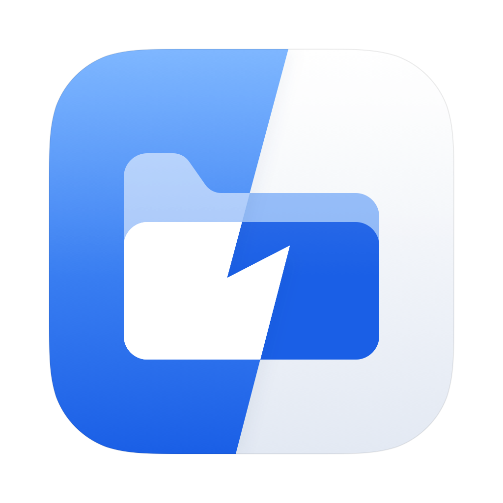

<p align="center"></p>

# Den

> [!WARNING]
> **Alpha (0.1.0-alpha). Not a public release.**
> This is an early, private build for testing. There are no downloads, no signed or notarized binaries, and no support.
> Things will change and break without notice. Please don't redistribute it.

Your whole Mac in one app: a file manager that remembers what you worked on, plus the small tools you'd otherwise install
one by one. Everything runs and stays on your Mac.

- **Files and memory:** browse folders, recents and projects; search names, contents and text in pictures; every answer links back to where it came from
- **⌥Space launcher:** apps, files, calculator, unit conversions, commands, clipboard history, window snapping (⌃⌥ arrows)
- **Notch:** today's meetings, a file shelf and a question box under the notch
- **Storage:** what's taking space and what's safe to clear, with the reason for each
- **RAM:** memory by app and what's growing
- **Calendar:** month, week and day, with your work alongside your meetings

## Build

Needs macOS 26 and Xcode 26 (the SwiftUI macros ship with Xcode, not the Command Line Tools).

```sh
cd app
./bundle.sh        # release build → app/Den.app (ad-hoc signed)
open Den.app
```

Self-check, which drives the real app model headless: `swift build && .build/debug/Den --check`

## Activity engine (optional)

`brain.py` collects what you touch (git commits, Claude Code prompts, browser history, notes) into `~/.brain/brain.db`,
which Den reads. It is also an MCP server so Claude can search the same history. See the header of `brain.py`.
`local.brain.sync.plist` runs a sync every 15 minutes; its paths are for the author's machine, so edit them first.

```sh
uv run brain.py sync
uv run test_brain.py
```

## Layout

- `app/Sources`: the SwiftUI app
- `app/Icon`: the icon (`Den.svg` is the source; `swift render.swift` makes `Den.icns`)
- `app/Parked/Dock`: a Dock replacement and widgets, parked and not compiled
- `brain.py`, `test_brain.py`: the activity engine and its test

## Credits

Icons: [Iconsax](https://github.com/lusaxweb/iconsax-react) (MIT). Folder animation adapted from uselayouts' folder-interaction.
